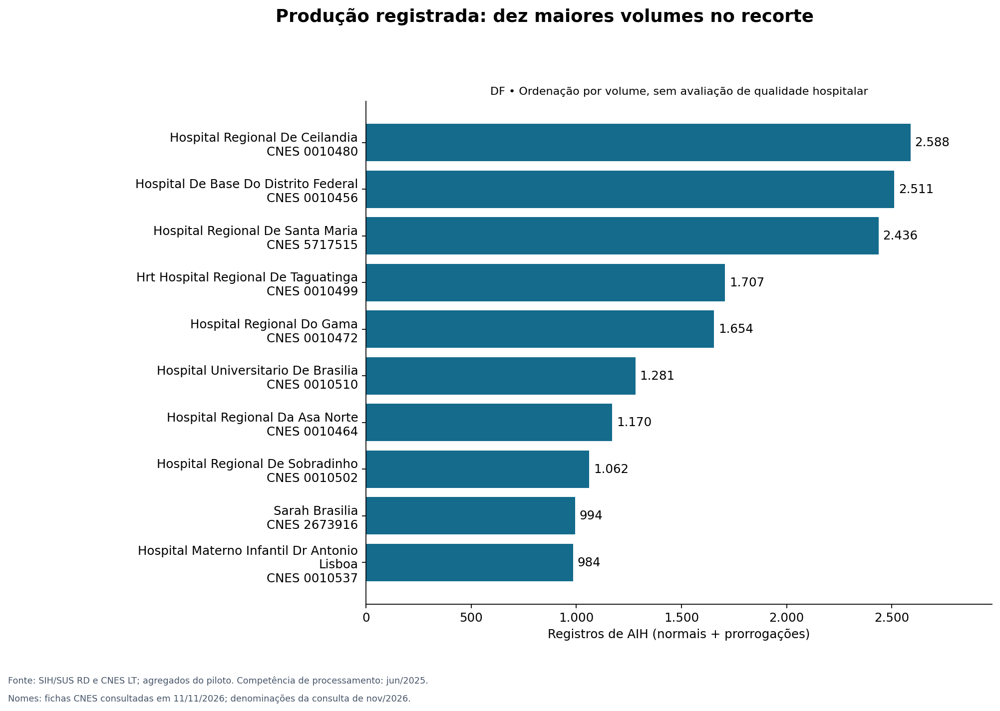
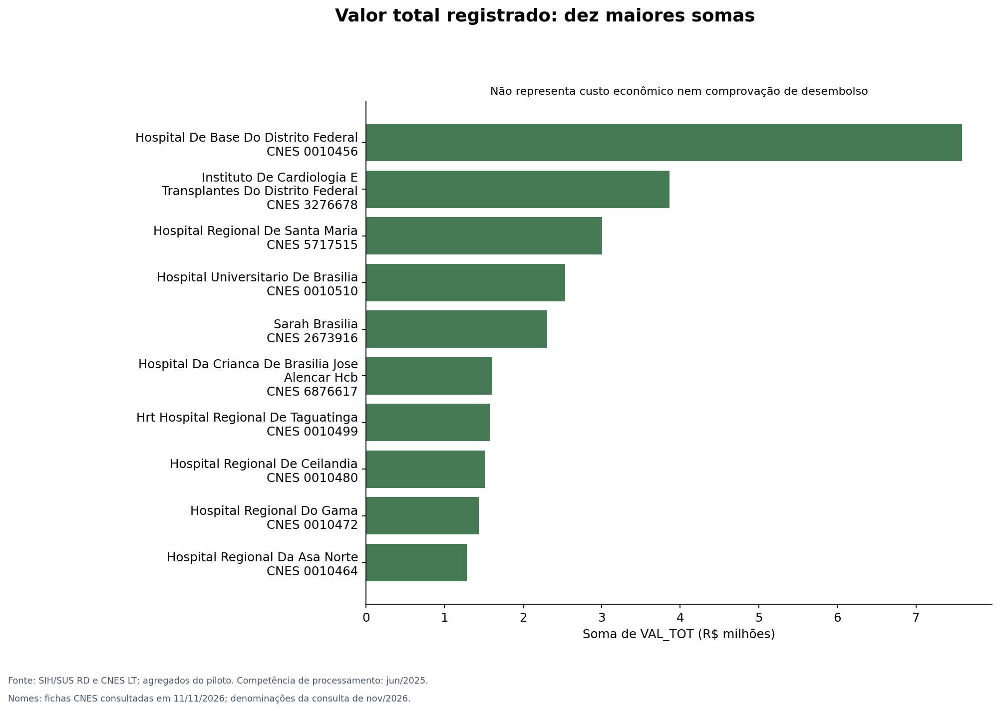
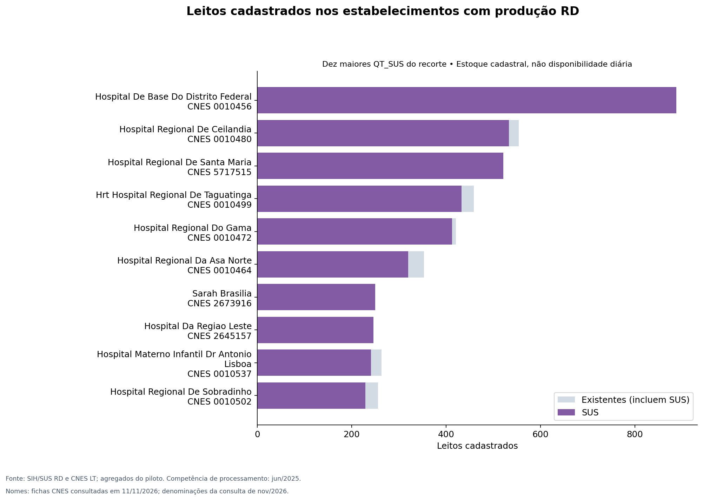
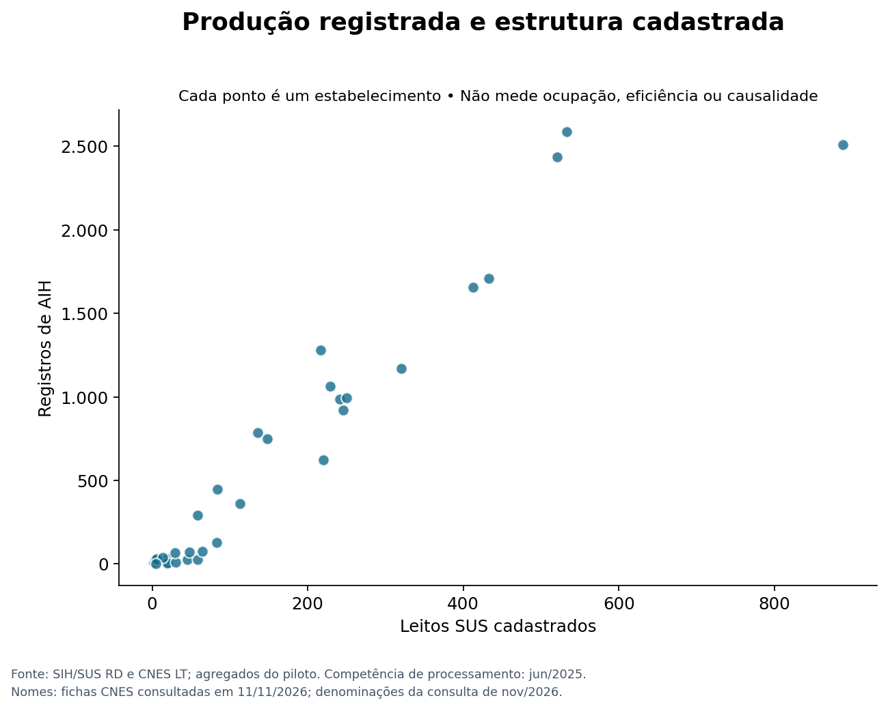

# Produção hospitalar e leitos cadastrados no Distrito Federal

Atividade de Ciência de Dados e Aprendizagem de Máquina — UDF. Análise descritiva orientada pelo CRISP-DM, com competência de processamento de junho de 2025.

**Integrantes:** Maurício Rafael Oliveira da Silva e Gabriel Silva dos Santos.

**Curso:** Sistemas de Informação — noturno.

## Pergunta principal
Como se distribuem os registros de AIH, os valores registrados e os leitos cadastrados entre os estabelecimentos com produção no SIH/SUS do Distrito Federal no recorte selecionado?

## Objetivo
Descrever e comparar produção administrativa e estrutura cadastrada com gráficos reproduzíveis e limites interpretativos explícitos. O recorte inclui prestadores do SUS, não somente estabelecimentos de propriedade pública.

## Reprodução da análise

Com Python 3.12 e as dependências instaladas, a análise pode ser reproduzida na pasta do projeto:

```bash
python -m pip install -r requirements.txt
python src/gerar_graficos.py
```

O [notebook executado](notebooks/analise.ipynb) apresenta as tabelas e os quatro gráficos incorporados às saídas das células. O script gera os mesmos resultados e mantém as figuras em PNG para consulta e reutilização.

## Gráficos e resultados






Os resultados e sua interpretação estão apresentados no [relatório de análise](docs/resultados_e_limitacoes.md). Os indicadores são calculados pelo script a partir dos dados agregados.

## Documentação
- [CRISP-DM e respostas ao roteiro](docs/metodologia_crisp_dm.md)
- [Perguntas de análise](docs/respostas_atividade.md)
- [Dicionário e procedência](dados/README.md)
- [Fontes](docs/fontes.md)

## Escopo e limitações
Esta versão adapta a modelagem para análise descritiva. O escopo é descritivo, sem treinamento de modelos de aprendizado de máquina. Não calcula taxa de ocupação, giro de leitos, custo econômico ou qualidade assistencial. A avaliação realizada abrange consistência interna, sem conciliação independente com o TABNET.

## Recursos de apoio

Ferramentas de inteligência artificial generativa (ChatGPT/Codex) foram utilizadas como apoio à estruturação textual, programação e verificação técnica. Os resultados numéricos apresentados foram obtidos pela execução do código sobre os dados agregados.


## Nomes dos estabelecimentos
Os nomes foram consultados nas fichas oficiais do CNES em 11/11/2026 e relacionados pelo código CNES com cardinalidade um para um. A tabela `dados/nomes_estabelecimentos.csv` preserva nome consultado, rótulo, URL e data da consulta. Para siglas isoladas (HRAN, HRG, HRS, HRPL, HRBZ, HRL e HRSM), foi usado o nome empresarial da mesma ficha. A capitalização foi ajustada apenas para leitura. As denominações correspondem à consulta de novembro/2026 e não constituem um cadastro histórico de junho/2025; os dados quantitativos continuam naquela competência. O arquivo ST inspecionado não contém campo de nome. Uma mudança de nome posterior não altera os valores nem autoriza deduzir mudanças de gestão.
